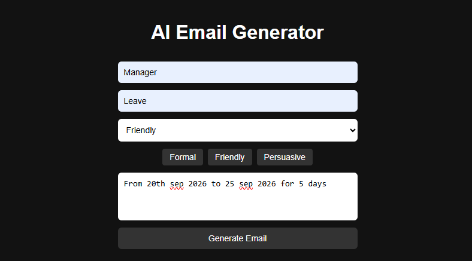
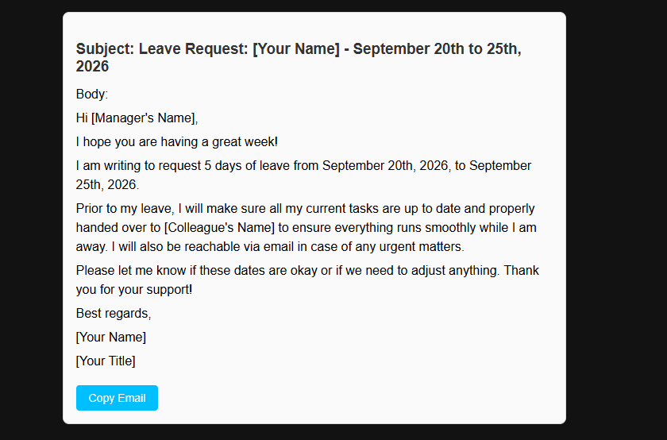
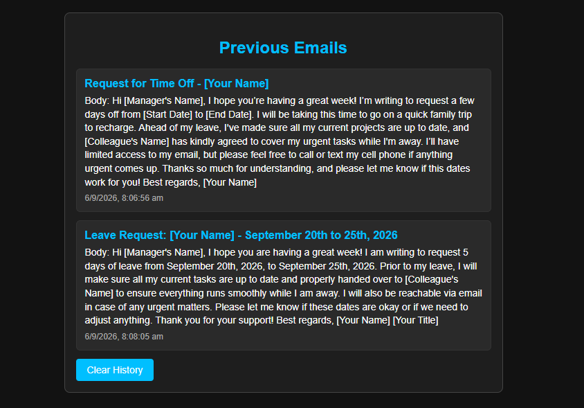

# AI Email Generator ✉️

An AI-powered email generator that helps users quickly create professional and well-structured emails based on the recipient, purpose, tone, and key points.

The application uses **React + Vite** for the frontend and the **Google Gemini API** for AI-powered email generation.

---

## 📖 Introduction

Writing professional emails can be time-consuming, especially when you need to find the right wording, tone, and structure.

The **AI Email Generator** simplifies this process by allowing users to provide basic email information such as:

* Recipient
* Purpose
* Tone
* Key Points

The application sends the information to the Gemini API and generates a polished email containing:

* Email Subject
* Professional Email Body

Users can also copy generated emails and view previously generated emails through the history section.

---

## 🚀 Features

### ✉️ AI Email Generation

Generate professional emails using the Google Gemini API based on user-provided information.

### 🎨 Tone Presets

Choose from different writing styles such as:

* Formal
* Friendly
* Persuasive

### ⏳ Loading Indicator

Displays a loading spinner while waiting for the AI-generated response.

### 📋 Copy to Clipboard

Copy the generated subject and email body with a single click.

### 🕘 Email History

Previously generated emails are stored in the browser using `localStorage`.

### 🗑️ Clear History

Users can clear all previously generated emails with one click.

### 📱 Responsive UI

The application is designed to work across desktop and mobile screen sizes.

---

## 🛠️ Tech Stack

### Frontend

* **React.js**
* **Vite**
* **JavaScript**
* **HTML5**
* **CSS3**

### AI Integration

* **Google Gemini API**

### Browser Storage

* **LocalStorage**

### Development Tools

* **VS Code**
* **Git**
* **GitHub**
* **npm**

---

## 🏗️ Application Architecture

```text
                ┌─────────────────────┐
                │      User           │
                └──────────┬──────────┘
                           │
                           ▼
                ┌─────────────────────┐
                │   React Frontend    │
                │                     │
                │  Email Form         │
                │  Tone Selection     │
                │  Email Result       │
                │  History            │
                └──────────┬──────────┘
                           │
                           ▼
                ┌─────────────────────┐
                │    AI Service       │
                │   aiService.js      │
                └──────────┬──────────┘
                           │
                           ▼
                ┌─────────────────────┐
                │   Gemini API        │
                │   Google AI         │
                └──────────┬──────────┘
                           │
                           ▼
                ┌─────────────────────┐
                │ Generated Email     │
                │                     │
                │ Subject + Body      │
                └──────────┬──────────┘
                           │
                           ▼
                ┌─────────────────────┐
                │ React UI            │
                │                     │
                │ Display / Copy      │
                └─────────────────────┘
```

---

## 📂 Project Structure

```text
ai-email-generator/
│
├── src/
│   │
│   ├── components/
│   │   ├── EmailForm.jsx
│   │   └── EmailResult.jsx
│   │
│   ├── services/
│   │   └── aiService.js
│   │
│   ├── App.jsx
│   ├── index.css
│   └── main.jsx
│
├── public/
│
├── .env
├── .gitignore
├── index.html
├── package.json
├── package-lock.json
└── README.md
```

---

## 🔄 Application Flow

```text
User enters email details
          │
          ▼
Select email tone
          │
          ▼
Click "Generate Email"
          │
          ▼
React prepares the prompt
          │
          ▼
Gemini API processes the request
          │
          ▼
Gemini generates:
Subject + Email Body
          │
          ▼
Result displayed in React
          │
          ├──────────────► Copy Email
          │
          └──────────────► Save to History
```

---

## ⚙️ Setup & Installation

### 1. Clone the Repository

```bash
git clone https://github.com/yourusername/ai-email-generator.git
```

Navigate into the project:

```bash
cd ai-email-generator
```

---

### 2. Install Dependencies

Run:

```bash
npm install
```

---

### 3. Configure Gemini API

Create a `.env` file in the project root:

```text
VITE_GEMINI_API_KEY=your_api_key_here
```

Replace:

```text
your_api_key_here
```

with your Gemini API key.

**Important:** Never commit your actual API key to GitHub.

Make sure `.env` is included in `.gitignore`:

```text
.env
```

---

### 4. Start the Development Server

Run:

```bash
npm run dev
```

Vite will start the development server.

Open the URL shown in the terminal, typically:

```text
http://localhost:5173
```

---

## 🎯 How to Use

### Step 1

Enter the recipient.

Example:

```text
HR Manager
```

### Step 2

Enter the purpose of the email.

Example:

```text
Job application follow-up
```

### Step 3

Select the desired tone.

Example:

```text
Professional
```

### Step 4

Enter the important points you want to include.

Example:

```text
Thank them for the interview and ask about the next steps.
```

### Step 5

Click:

```text
Generate Email
```

### Step 6

The application generates:

```text
Subject
+
Email Body
```

### Step 7

Use **Copy Email** to copy the generated email.

### Step 8

View previous generated emails in the **History** section.

---

## 📌 Example

### Input

**Recipient**

```text
HR Manager
```

**Purpose**

```text
Job application follow-up
```

**Tone**

```text
Professional
```

**Key Points**

```text
Thank them for the interview and ask about the next steps.
```

### Generated Output

```text
Subject: Follow-Up on Interview

Dear HR Manager,

Thank you once again for the opportunity to interview. I truly
appreciated our discussion and learning more about the role.

I wanted to kindly follow up regarding the next steps in the
hiring process. Please let me know if there are any additional
details or information required from my side.

I look forward to hearing from you.

Best regards,
[Your Name]
```

---

## 🔐 Environment Variables

The application uses an environment variable for the Gemini API key.

```text
VITE_GEMINI_API_KEY=your_api_key_here
```

### Important Security Note

Do not upload your `.env` file to GitHub.

Your `.gitignore` should contain:

```text
.env
node_modules/
dist/
```

If the API key is exposed publicly, revoke the key and generate a new one.

> **Production recommendation:** For a production deployment, the Gemini API key should be kept on a backend/server-side service rather than exposed through a Vite frontend environment variable.

---

## 🧩 Main Components

### EmailForm.jsx

Responsible for:

* Collecting recipient information
* Collecting email purpose
* Selecting email tone
* Collecting key points
* Triggering email generation

### EmailResult.jsx

Responsible for:

* Displaying generated subject
* Displaying generated email body
* Copying email content
* Displaying generated results

### aiService.js

Responsible for:

* Preparing the AI prompt
* Calling the Gemini API
* Processing the Gemini response
* Returning the generated email

### App.jsx

Responsible for:

* Combining application components
* Managing application state
* Managing email history
* Connecting the main UI sections

---

## 💾 Local Storage

The application uses browser `localStorage` to save previously generated emails.

Example:

```text
Generated Email
      │
      ▼
Browser LocalStorage
      │
      ▼
Email History
```

This allows users to view their previous emails even after refreshing the page.

---

## 🧪 Testing

The application can be tested using different combinations of:

### Recipients

```text
HR Manager
Client
Manager
Professor
Recruiter
Customer
```

### Tones

```text
Formal
Friendly
Persuasive
Professional
```

### Purposes

```text
Job Application
Leave Request
Meeting Request
Follow-up
Thank You
Project Update
```

---

## 📦 Available Scripts

### Start Development Server

```bash
npm run dev
```

### Build for Production

```bash
npm run build
```

### Preview Production Build

```bash
npm run preview
```
---

## 🔮 Future Improvements

The project can be extended with the following features:

* 🌙 Dark/Light mode
* 📄 Export email as PDF
* 📧 Gmail integration
* 📬 Outlook integration
* 👤 User authentication
* ☁️ Cloud-based email history
* ✏️ Edit generated emails
* 🔄 Regenerate email
* 🌐 Multiple language support
* 🎤 Voice-to-email generation
* 📊 Email generation analytics
* 🔐 Backend API for secure Gemini integration

---

## 🎓 Learning Outcomes

Through this project, the following concepts were practiced:

* React component development
* React state management
* Form handling
* API integration
* Gemini API integration
* Asynchronous JavaScript
* Loading states
* Error handling
* Clipboard API
* Browser LocalStorage
* Environment variables
* Vite development
* Git and GitHub
* Frontend deployment

---

## 📸 Screenshots

Add screenshots of your application here.

Example:

```text
screenshots/
├── home-page.png
├── generated-email.png
└── email-history.png
```

Then add them to this section:

```markdown





```

---

## 👨‍💻 Author

**Manikandan S**

Java Backend Developer | Spring Boot Developer | Software Engineer

---

## 📜 License

This project is licensed under the **MIT License**.

You are free to use, modify, and distribute this project for personal or educational purposes.

---

## ⭐ Support

If you find this project useful, consider giving the repository a ⭐ on GitHub.

---

## 🔗 Project

**AI Email Generator**

An AI-powered application that uses React and Google Gemini API to generate professional emails quickly and efficiently.
